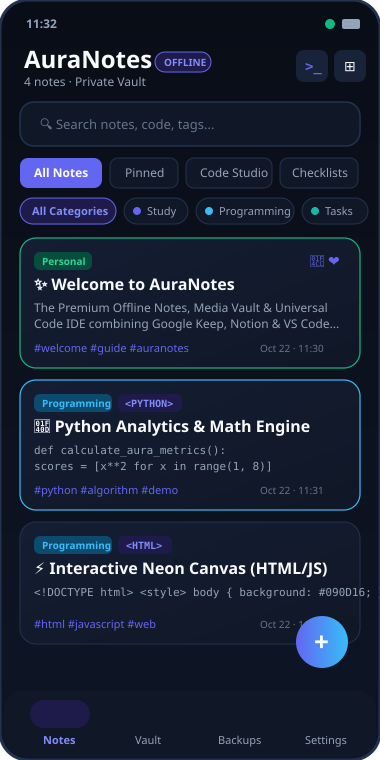
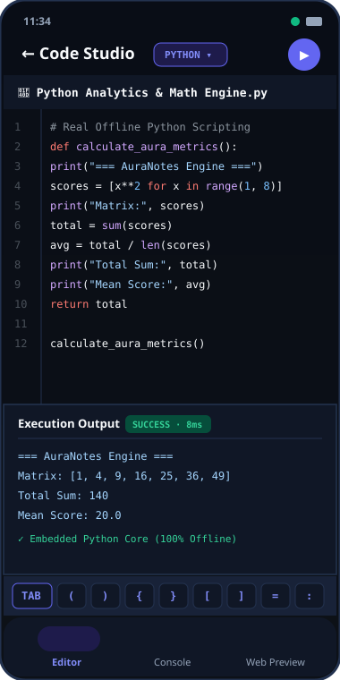
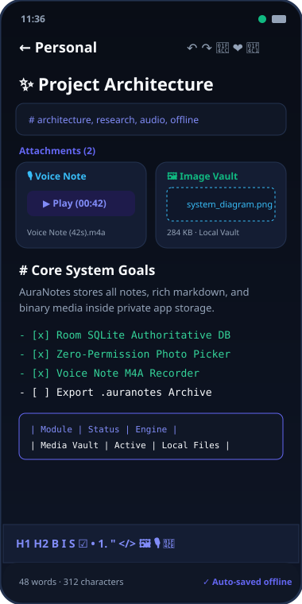
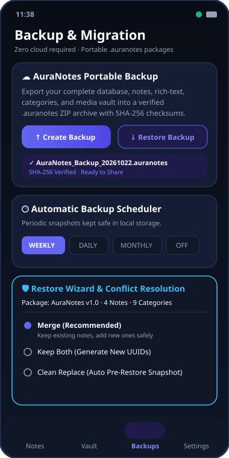

# AuraNotes
> **Premium Android Notes, Media Vault & Universal Code IDE**  
> **Author:** Jamshed Ali >> [jamshedali.me](https://jamshedali.me) (`Jamshed Ali >>jamshedali.me`)  
> **Organization:** AuraNix Technologies  
> **Platform:** Android Phones & Tablets | 100% Offline-First

---

## 🌟 Overview

**AuraNotes** merges the simplicity of **Google Keep**, the structured depth and linking of **Notion & Obsidian**, and the developer versatility of a **Universal Code IDE**. Designed with a refined obsidian glassmorphism aesthetic, soft neon gradients, and responsive layouts, AuraNotes guarantees total privacy and zero-cloud dependency.

---

## 📸 Project Screenshots

| 🏠 Home Dashboard & Vault | 💻 Universal Code Studio |
| :---: | :---: |
|  |  |
| *Category filtering, tag search, pinned notes & quick actions* | *Syntax highlighting, line numbers, symbol bar & offline Python execution* |

| ✍️ Rich-Text Editor & Media Vault | 📦 Portable Backup & Restore Wizard |
| :---: | :---: |
|  |  |
| *Markdown toolbar, voice note recorder, photo & document carousel* | *SHA-256 verified `.auranotes` archive & conflict resolution wizard* |

---

## 🚀 Key Features

### 1. ✍️ Universal Notes System
- **Plain & Rich Text**: Markdown formatting with headings (H1, H2), bold, italics, strikethrough, blockquotes, horizontal dividers, tables, and hyperlinks.
- **Interactive Checklists**: Real-time task tracking with instant checkbox toggles.
- **Organization**: Categories (Study, Programming, Projects, Personal, Research, Work, Ideas, Tasks, Media), custom tags, folders, pinned notes, favorites, archiving, and recycle bin (Trash) with recovery.
- **Auto-Saving & Draft Safety**: Debounced automatic database commits with full undo/redo history.

### 2. 💻 Universal Code Studio & Real Offline Execution
- **Multi-Language Support**: Python, JavaScript, HTML, CSS, SQL, Kotlin, Java, C/C++, Rust, Go, Bash, Swift, Dart, JSON, Markdown, Ruby, and C#.
- **Syntax Highlighting & Line Numbers**: Monospace code canvas with line counters, syntax tokenization, and bracket matching.
- **Developer Quick-Symbol Bar**: Rapid access to code brackets `( ) { } [ ] < > " ' : ; = . / \ $ # _`.
- **Real Execution**:
  - **Embedded Python Sandbox**: Real local script execution with variables, loops, data structures, arithmetic, and stdout/stderr capture.
  - **Interactive Sandboxed Webview**: Live execution of HTML5, CSS3, and JavaScript with `console.log` interception.
  - **In-Memory SQLite Engine**: Run SQL queries, create tables, insert records, and inspect ASCII result grids.
  - **Code Templates**: Built-in starters for algorithms, web counters, and database schemas.

### 3. 🛡️ Media Vault & Local Storage
- **Offline Attachment Vault**: Store images, voice recordings, PDFs, and documents in app-private storage (`filesDir/media_vault/`).
- **Voice Note Recorder**: Built-in audio recorder with duration timer and immediate audio preview playback.
- **Photo & Document Pickers**: Zero-broad-permission Android Photo Picker and Storage Access Framework document integration.
- **Sharing**: Android `FileProvider` export for external apps.

### 4. 📦 Portable Backup & Migration Manager (`.auranotes`)
- **Complete Portable Archive**: Versioned ZIP container bundling `manifest.json`, `notes.json`, `categories.json`, `attachments.json`, and all binary media files with SHA-256 integrity verification.
- **JSON Export**: Human-readable JSON export option.
- **Restore Wizard**:
  1. Inspect package and display note, category, and attachment counts.
  2. Detect ID conflicts.
  3. Resolution strategies: **Merge** (keep existing, add new), **Keep Both** (assign unique IDs), or **Clean Replace** (with automatic pre-restore safety snapshot).
  4. Instant migration between any two Android devices with zero cloud account required.

### 5. 🎨 Aura Glassmorphism Design
- **Color Themes**: Deep Obsidian Charcoal Dark Mode, crisp Alabaster Light Mode, and System Default.
- **Radiant Accents**: Violet, Cyber Cyan, Emerald, Rose, and Amber.
- **Command Palette**: Instant navigation and command triggers via `Ctrl+Shift+P` / terminal action.
- **Responsive Adaptive Layout**: Optimized for both handheld phones and tablets.

---

## 🛠️ Build & Installation

### Requirements
- Android Studio Ladybug / Meerkat or newer
- JDK 17 or JDK 21
- Android SDK 36 (minSdk 24)

### Building the Project
```bash
# Clone or open the repository in Android Studio
# Build the debug APK via Gradle:
gradle assembleDebug

# Run unit and Robolectric tests:
gradle :app:testDebugUnitTest
```
The generated APK will be located at:
`app/build/outputs/apk/debug/app-debug.apk`

---

## 👨‍💻 Author

**Jamshed Ali (https://jamshedali.me)**  
- 🌐 Website: [jamshedali.me](https://jamshedali.me)  
- 🏢 Brand: AuraNix Technologies

---

## 📄 License
© 2026 Jamshed Ali ([jamshedali.me](https://jamshedali.me)) & AuraNix Technologies. All rights reserved.
