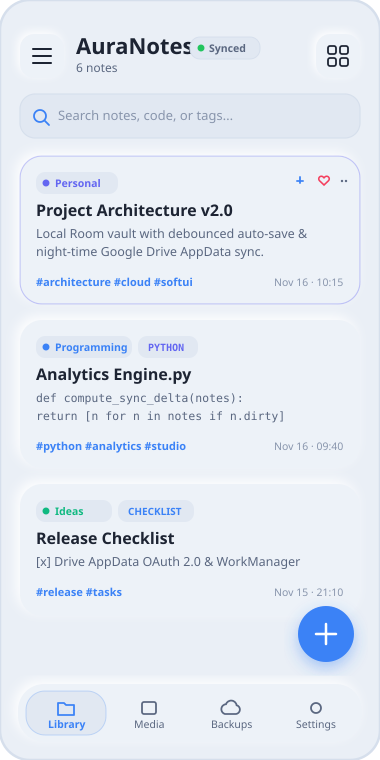
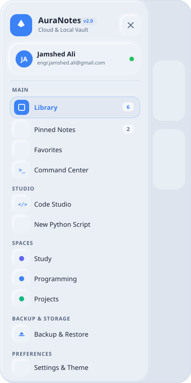
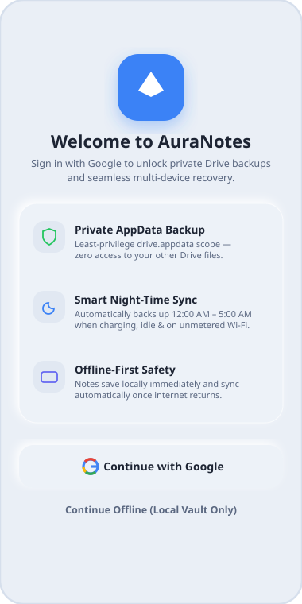
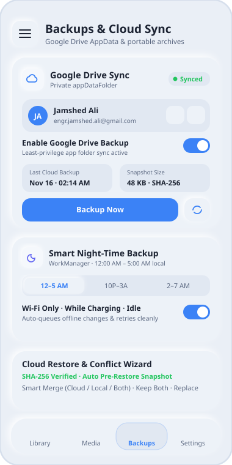
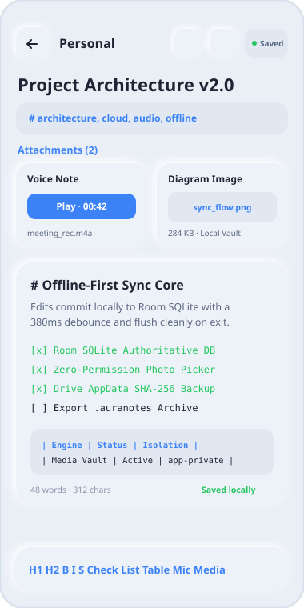
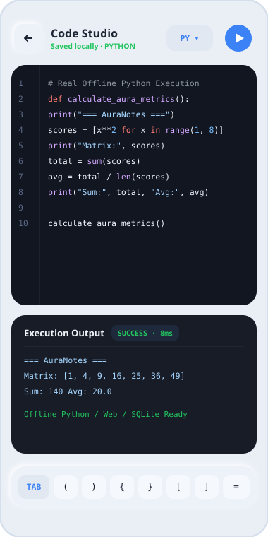

# AuraNotes v2.0

> **Premium Android Notes, Media Vault, Universal Code Studio & Google Drive Smart Sync**  
> **Author:** Jamshed Ali >> [jamshedali.me](https://jamshedali.me)  
> **Organization:** AuraNix Technologies  
> **Platform:** Android Phones & Tablets (SDK 24–36) · Offline-First with Private Google Drive Sync

---

## Overview

**AuraNotes v2.0** brings together the immediacy of **Google Keep**, the structured depth of **Notion & Obsidian**, and the developer versatility of a **Universal Code IDE** inside a cohesive **Neumorphic Soft UI & Glassmorphism** Android interface.

Designed around a local-first **Room SQLite** database and private media vault, AuraNotes keeps everything responsive offline while adding **Google Sign-In**, least-privilege **Google Drive `appDataFolder` backups**, and **WorkManager smart night-time sync** with conflict-safe restoration.

---

## Project Screenshots

| Home Dashboard & Soft UI Vault | Expandable Drawer & Command Center |
| :---: | :---: |
|  |  |
| *Cloud White Soft UI, live sync indicator, Grid/List toggle, recessed search, and floating Neumorphic dock* | *Google profile identity, collapsible sections, Spaces color dots, Backup Center, and Command Center trigger* |

| Google Sign-In & Onboarding | Cloud Backup & Smart Night-Time Sync |
| :---: | :---: |
|  |  |
| *One-tap Credential Manager Google Sign-In (`drive.appdata`) or full offline vault mode* | *Automated Drive `appDataFolder` sync, night-time schedule presets, Wi-Fi/charging constraints, and SHA-256 restore* |

| Rich-Text Editor & Media Vault | Universal Code Studio & Sandbox |
| :---: | :---: |
|  |  |
| *Markdown toolbar, M4A voice notes, photo attachments, interactive checklists, and debounced auto-save* | *Dark syntax-highlighted IDE canvas, 17 languages, quick-symbol bar, and offline Python / Web / SQLite execution* |

---

## Key Features

### 1. Neumorphic Soft UI & Adaptive Navigation
- **Soft UI Surfaces**: Dual-direction raised and recessed surfaces across **Cloud White (`#EAEFF6`)** light mode and **Soft Charcoal Slate (`#1E2330`)** dark mode, plus System Default follow.
- **5 Curated Accents**: **Blue** (`#3B82F6`), **Violet** (`#6366F1`), **Emerald Mint** (`#10B981`), **Coral Rose** (`#F43F5E`), and **Solar Amber** (`#F59E0B`).
- **Lucide Stroke Iconography**: Custom unified vector stroke icon library (`AuraIcons`) replacing inconsistent symbols across toolbars, cards, and navigation.
- **Responsive Phone & Tablet Layouts**: Floating Neumorphic bottom dock + Grid/List note toggle on compact screens, paired with a collapsible drawer and adaptive navigation rail on tablets.
- **Command Center**: Instant quick-switcher, navigation, and note creation via the drawer's Command Center trigger (`CommandPaletteDialog`).
- **Accessibility Modes**: Built-in **Reduce Motion**, **Reduce Transparency**, and **High Contrast** toggles.

### 2. Google Authentication & Automatic Google Drive Sync
- **Official Passwordless Sign-In**: Uses Jetpack **Credential Manager** (`GetGoogleIdOption` / `GetSignInWithGoogleOption`) and **Firebase Auth**, displaying the user's Google profile avatar, name, email, and live sync indicator (`Synced`, `Offline`, `Syncing`).
- **Least-Privilege Private Cloud Folder**: Uses Google Drive v3 **`drive.appdata`** (`appDataFolder`) scope via `Identity.getAuthorizationClient(...)`. Short-lived access tokens are requested dynamically—never storing passwords or refresh tokens on disk, and never reading personal Google Drive files.
- **Deduplicated Incremental Sync**: Maintains `backup-latest.json` plus pruned historical snapshots (`backup-yyyy-MM-dd_HHmmss.json`) with **SHA-256** content hashing and `payloadChecksumSha256` verification.
- **Smart Night-Time Scheduler**: Powered by Jetpack **WorkManager** (`NighttimeBackupScheduler` + `DriveBackupWorker`) with presets (`12:00 AM – 5:00 AM`, `10:00 PM – 3:00 AM`, `2:00 AM – 7:00 AM`), configurable **Wi-Fi Only**, **While Charging**, and **Device Idle** constraints, plus exponential backoff and a 12-second debounced auto-sync after edits.
- **Conflict-Safe Restore Wizard**: Automatically captures a pre-restore safety snapshot (`SAFETY_PRE_RESTORE`) before applying **Smart Merge** (per-note `Use Cloud`, `Keep Local`, or `Keep Both`), **Keep Both**, or **Clean Replace**, with optional user preference restoration.
- See [`docs/GOOGLE_DRIVE_SETUP.md`](docs/GOOGLE_DRIVE_SETUP.md) for Cloud Console & OAuth details.

### 3. Universal Notes & Organization
- **Rich Markdown & Checklists**: Headings, bold, italic, strikethrough, blockquotes, dividers, tables, hyperlinks, and interactive task checkboxes.
- **Debounced Auto-Save & History**: Automatic Room database persistence (`380ms` debounce) with undo/redo support.
- **Spaces & Lifecycle Management**: Built-in and custom Spaces (`Study`, `Programming`, `Projects`, `Personal`, `Research`, `Work`, `Ideas`, `Tasks`, `Media`), tags, **Pinned Notes**, **Favorites**, **Archive**, and recoverable **Trash**.

### 4. Universal Code Studio & Offline Execution
- **17 Syntax-Highlighted Languages**: Python, JavaScript, HTML, CSS, SQL, Kotlin, Java, C/C++, Rust, Go, Bash, Swift, Dart, JSON, Markdown, Ruby, and C#.
- **High-Contrast Developer Canvas**: Line numbers, tokenized highlighting, starter templates, and a horizontal **Quick-Symbol Bar** (`( ) { } [ ] < > " ' : ; = . / \ $ # _`).
- **Local Execution Engines**:
  - **Python Sandbox**: Local execution with variables, loops, functions, data structures, and stdout/stderr output console.
  - **Interactive Web Sandbox**: Embedded HTML5/CSS3/JS execution with `console.log` capture.
  - **In-Memory SQLite Engine**: Run `CREATE TABLE`, `INSERT`, and `SELECT` queries directly with formatted tabular output.

### 5. Offline Media Vault & Portable `.auranotes` Backups
- **Media Vault (`filesDir/media_vault/`)**: Stores captured M4A voice notes (with live duration timer and playback), Photo Picker images (zero broad storage permissions), and SAF PDF/document attachments, shareable via Android `FileProvider`.
- **Portable Backup Archives (`filesDir/backups/`)**: Generates timestamped ZIP archives (`AuraNotes_Backup_yyyyMMdd_HHmmss.auranotes`) bundling `manifest.json`, `notes.json`, `categories.json`, `attachments.json`, binary vault files, and SHA-256 verification.

---

## Architecture & Package Structure

```text
app/src/main/java/com/example/
├── MainActivity.kt
├── auth/
│   └── GoogleAuthManager.kt             # Credential Manager + Firebase Auth + OAuth token flow
├── cloud/
│   ├── CloudBackupModels.kt             # Versioned v2 cloud payload & conflict DTOs
│   ├── CloudSyncCoordinator.kt          # Deduplicated sync, conflict resolution & restore orchestration
│   ├── ConnectivityMonitor.kt           # Live network state observer
│   ├── DriveBackupWorker.kt             # WorkManager background Drive upload worker
│   ├── GoogleDriveClient.kt             # Google Drive v3 appDataFolder REST client (OkHttp)
│   └── NighttimeBackupScheduler.kt      # Windowed night-time backup scheduler & constraints
├── data/local/
│   ├── AuraDatabase.kt                  # Room database, Entities & DAOs
│   └── PreferencesRepository.kt         # DataStore preferences & CloudSyncStatus persistence
├── domain/
│   ├── BackupManager.kt                 # Local .auranotes ZIP export/import & safety snapshots
│   ├── CodeExecutionEngine.kt           # Offline Python / SQLite / Web execution engines
│   └── NoteRepository.kt                # Repository coordinating Room, Media Vault & Sync triggers
└── ui/
    ├── AuraMainApp.kt                   # Adaptive shell, navigation & sync banner coordination
    ├── components/                      # AuraIcons, Neumorphic primitives, Drawer, Command Center
    ├── screens/                         # Home, RichTextEditor, CodeStudio, MediaVault, Backup, Settings, GoogleSignIn
    └── theme/                           # Cloud White & Soft Charcoal tokens, Type & Accent schemes
```

---

## Storage Locations on Android

| Data Type | Storage Location |
| :--- | :--- |
| **Notes, Categories, Metadata** | App-private Room SQLite database (`/data/data/com.aistudio.auranotes.hqztxy/databases/`) |
| **Preferences & Sync Metadata** | Jetpack DataStore (`/data/data/com.aistudio.auranotes.hqztxy/files/datastore/`) |
| **Voice Notes, Images & Docs** | `context.filesDir/media_vault/` |
| **Portable `.auranotes` Archives** | `context.filesDir/backups/AuraNotes_Backup_yyyyMMdd_HHmmss.auranotes` |
| **Cloud Synced Backups** | Hidden Google Drive **`appDataFolder`** (`backup-latest.json` & timestamped snapshots) |

---

## Build, Verification & Pre-Built APKs

### Requirements
- **Android Studio** Ladybug / Meerkat or newer
- **JDK** 17 or 21
- **Android SDK** 36 (`minSdk = 24`, `targetSdk = 36`)
- **Application ID**: `com.aistudio.auranotes.hqztxy` (`versionName = "2.0"`, `versionCode = 2`)

### Gradle Commands
```bash
# Build the debug APK:
gradle assembleDebug

# Run all unit and Robolectric tests (including CloudBackupAndSyncTest):
gradle :app:testDebugUnitTest
```

### APK Outputs
- **Gradle Debug Output**: `app/build/outputs/apk/debug/app-debug.apk`
- **Packaged Builds**:
  - `builds/AuraNotes.apk`
  - `builds/AuraNotes-v2.0.apk`

---

## Author

**Jamshed Ali** — [jamshedali.me](https://jamshedali.me)  
**AuraNix Technologies**

---

## License
© 2026 Jamshed Ali ([jamshedali.me](https://jamshedali.me)) & AuraNix Technologies. All rights reserved.
